# Auto Posto Oásis - Documento de Estudo 07: Melhorias de UI/UX, Padrão MVC, Metáforas do Mundo Real e Auditoria

Este documento consolida as implementações realizadas no sistema **Auto Posto Oásis**, detalhando como as solicitações de melhoria de usabilidade (UI/UX) foram atendidas em estrita conformidade com os slides de *Fundamentos para o Projeto de Interfaces do Usuário* (Prof. Dr. Alan Gavioli - UTFPR) e o documento de requisitos *TrabalhoPostoEntrega.pdf*.

---

## 1. Mapeamento das Melhorias Implementadas e Conformidade

| Perfil / Área | Solicitação do Usuário | Princípio de UI/UX & Regra Acadêmica | Implementação Técnica |
| :--- | :--- | :--- | :--- |
| **Geral / Visual** | Fundo Claro/Escuro e paleta neutra e descansada | **Design com Estética e Minimalismo** (Slide 17) & **Consistência** (Slide 15) | Suporte nativo a `ThemeDictionaries` (Dark/Light em Slate) e botão de alternância de tema no cabeçalho. |
| **Login** | Bloquear acesso direto sem senha ao clicar no perfil | **UC16 / RF16 / RNF08** (Autenticação obrigatória com credenciais e segurança) | Clicar em um perfil preenche o nome e usuário, exigindo a digitação da senha cadastrada (`123`) para autorizar a entrada. |
| **Gerente** | Tornar cards de faturamento clicáveis com detalhes (datas, horas, operadores) | **RF20 / RNF10 / Reconhecimento em vez de lembrança** (Slide 16) | Cards de KPI são botões interativos que acionam *drill-down* analítico com listagem de vendas, operadores, combustível, clientes e status. |
| **Frentista** | Iniciar e parar a contagem contínua ao clicar em "Livre (Normal)" | **RF01 / RN12 / Metáfora do Mundo Real - Gatilho da Bomba** (Slide 8) | Botão liga/desliga acoplado a um `DispatcherTimer` (pulsos de combustível em tempo real) com corte automático ao atingir 4% (RN12). |
| **Caixa** | Simulação de maquininha de cartão ao escolher Débito/Crédito | **RN01 / Metáfora da Máquina POS** (Slide 8 - Correspondência com o mundo real) | Painel interativo de TEF/POS com opções de aproximação (NFC) e inserção de chip/senha, bloqueando a venda até aprovação da adquirente. |
| **Auxiliar Adm** | Relação de fornecedores cadastrados (conveniência e combustíveis) | **RF09 / RF13 / RN08 / RN15** (Bandeira Petrobras exclusiva e validação CNPJ) | Tabela visual com todos os fornecedores homologados, CNPJ validado e indicação de categoria (Distribuidora de Combustíveis vs. Conveniência). |

---

## 2. Padrão Arquitetural MVC Aplicado na Apresentação

O projeto adota o padrão **MVC (Model-View-Controller)** para separar as responsabilidades:

```mermaid
flowchart LR
    subgraph View ["Camada de Apresentação (Views Avalonia)"]
        V_Login["LoginView.axaml"]
        V_Frentista["FrentistaView.axaml"]
        V_Caixa["CaixaView.axaml"]
        V_Adm["AuxiliarAdmView.axaml"]
        V_Gerente["GerenteView.axaml"]
    end

    subgraph Controller ["Controladores de Aplicação"]
        C_Login["LoginController"]
        C_Frentista["FrentistaController"]
        C_Caixa["CaixaController"]
        C_Adm["AuxiliarAdmController"]
        C_Gerente["GerenteController"]
    end

    subgraph Model ["Camada de Domínio & Persistência"]
        M_Bomba["Bomba & Tanque"]
        M_Venda["Venda & ItemVenda"]
        M_Func["Funcionario & Fornecedor"]
        M_Repo["IPostoRepository (Seed / Dados)"]
    end

    View -->|Dispara Ações do Usuário| Controller
    Controller -->|Executa Regras de Negócio e Validações| Model
    Model -->|Atualiza Estado| View
```

---

## 3. Guia de Telas para Tirar Prints para o Professor

Ao gerar os relatórios e evidências do trabalho acadêmico, utilize as telas correspondentes:

1. **Tela de Login (`LoginView.axaml`)**:
   - **Badges visíveis**: `UC16 / RF16: Autenticação com Senha`, `RNF08: Controle de Acesso por Perfil`.
   - **O que destacar**: O usuário seleciona o perfil desejado e o sistema bloqueia o acesso até que a senha seja validada.

2. **Tela do Frentista (`FrentistaView.axaml`)**:
   - **Badges visíveis**: `UC1 / RF01: Abastecimento em Pista`, `RN12: Corte Automático Tanque < 4%`, `RN09: Calote / Vencimento Dia 05`, `RF17: Ponto Eletrônico`.
   - **O que destacar**: O mostrador digital da bomba com contagem contínua automática (botão `▶️/⏸️ Fluxo Livre`) e o botão de bater ponto.

3. **Tela de Frente de Caixa (`CaixaView.axaml`)**:
   - **Badges visíveis**: `UC2 / RF02: PDV Integrado`, `RN01: Formas de Pagamento`, `RN03: Vale-Lavagem R$ 200`, `RF03: Nota Fiscal (NF-e)`, `RN17: Cancelamento 30 Min`.
   - **O que destacar**: A maquininha POS interativa que simula a aproximação e inserção de chip antes de permitir a emissão do cupom fiscal.

4. **Tela Administrativa & RH (`AuxiliarAdmView.axaml`)**:
   - **Badges visíveis**: `RF15: Dados Colaboradores`, `RN04: Validação Matemática CPF`, `RN05: Piso Salarial`, `RF09 / RN15: Petrobras Distribuidora`, `RF18: Desativação Imediata`.
   - **O que destacar**: Tabela de colaboradores admitidos e a tabela de fornecedores com validação matemática de CNPJ (RN08) e Petrobras como bandeira exclusiva (RN15).

5. **Tela da Gerência (`GerenteView.axaml`)**:
   - **Badges visíveis**: `RNF10: Reajuste Fácil de Preços`, `RF11: CRUD Produtos`, `RN19: Homologação Perdas`, `RN16: Fechamento c/ Gerente`, `RF20: Relatórios Gerenciais`.
   - **O que destacar**: Os 4 cards executivos de faturamento clicáveis que abrem a tabela analítica com o detalhamento de cada transação (data, hora, operador, cliente e valor).
