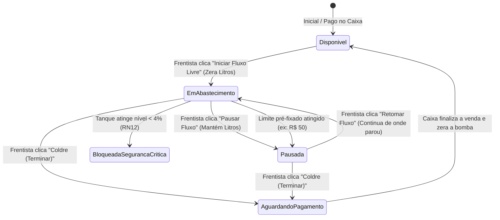

# Auto Posto Oásis - Documento de Estudo 08: Correções no Fluxo Contínuo da Bomba e Validação de CPF para Testes

Este documento detalha as soluções técnicas implementadas para atender aos feedbacks do usuário nos perfis de **Frentista** e **Auxiliar Administrativo / RH**, aplicando os padrões de Orientação a Objetos e boas práticas de interface reativa em Avalonia UI.

---

## 1. Problema 1: Atualização em Tempo Real e Máquina de Estados da Bomba (Pista)

### Diagnóstico do Problema
1. **Visor Congelado**: A classe `Bomba` não implementava `INotifyPropertyChanged`. Ao receber pulsos contínuos via timer, o objeto atualizava seus campos internos, mas a interface gráfica do Avalonia não era notificada de que as propriedades `LitrosAbastecidos` e `ValorTotalCalculado` haviam sido alteradas. O valor só aparecia quando o usuário clicava em parar, pois a tela forçava um recarregamento da coleção.
2. **Perda de Litros ao Reclicar**: O método de inicialização zerava os litros incondicionalmente (`LitrosAbastecidos = 0.0`), tratando cada clique como um novo abastecimento em vez de permitir **pausar e retomar**.

### Solução Arquitetural Implementada
Foi implementada uma **Máquina de Estados de Abastecimento** com notificações reativas completas:

#### Código Reativo na Entidade `Bomba` (`PostoOasis.Core.Models`):
* Implementa `INotifyPropertyChanged`.
* Ao alterar `LitrosAbastecidos`, dispara notificações automáticas para `ValorTotalCalculado`, `TextoStatus` e `TextoBotaoFluxo`.
* O método `IniciarOuRetomarAbastecimento` só zera os litros se a bomba estiver em estado inicial ou após pagamento; se estiver em estado `Pausada`, **continua exatamente de onde o abastecimento havia parado**.
* O botão da bomba adapta seu rótulo e comportamento dinamicamente:
  * `▶️ Iniciar Fluxo Livre` (quando disponível);
  * `⏸️ Pausar Fluxo` (durante o bombeamento contínuo);
  * `▶️ Retomar Fluxo` (quando pausada).
* O abastecimento só é definitivamente encerrado quando o frentista clica em **`🔒 Coldre (Terminar)`**, liberando o valor para pagamento no Caixa.

---

## 2. Problema 2: Validação de CPF para Testes no Perfil RH / Administrativo

### Diagnóstico do Problema
* O sistema executava a validação matemática estrita com os dois dígitos verificadores (módulo 11) via `ValidadorDocumento.ValidarCpf`.
* Durante a apresentação do trabalho e testes em sala de aula, digitar CPFs reais ou calcular dígitos verificadores válidos tornava a experimentação das telas lenta e propensa a erros de digitação.

### Solução Arquitetural Implementada
* **Regra Flexibilizada para Testes**: O sistema aceita qualquer sequência numérica de **11 dígitos** (ex.: `11122233344`, `12345678901`, etc.), com ou sem máscara de pontuação.
* **Garantia de Unicidade**: O sistema mantém a consistência do banco de dados impedindo **duplicidade de CPF**. Se o usuário tentar cadastrar um CPF já pertencente a outro colaborador (como os já cadastrados na inicialização), o sistema alerta em vermelho que o documento já existe.
* **Preservação das demais regras**: A validação do piso salarial da categoria (**RN05**) e a desativação de funcionários (**RF18**) continuam ativas e operacionais.

---

## 3. Resumo dos Componentes Alterados

1. **`PostoOasis.Core/Models/Bomba.cs`**:
   - Adicionada interface `INotifyPropertyChanged`;
   - Implementados estados `Pausada` e `AguardandoPagamento`;
   - Implementado método `IniciarOuRetomarAbastecimento` e propriedades `TextoStatus` e `TextoBotaoFluxo`.
2. **`PostoOasis.App/Controllers/AuxiliarAdmController.cs`**:
   - Ajustada validação de CPF para aceitar qualquer sequência de 11 dígitos mantendo checagem de não-repetição no posto.
3. **`PostoOasis.App/Controllers/FrentistaController.cs`**:
   - Suporte a pausa, retomada e fechamento no coldre.
4. **`PostoOasis.App/Controllers/CaixaController.cs`**:
   - Reset automático da bomba após quitação no caixa (`Litros = 0` e `Status = Disponivel`).
5. **`PostoOasis.App/ViewModels/MainWindowViewModel.cs`**:
   - DispatcherTimer a 150ms atualizando o objeto da bomba sem destruir a lista da tela;
   - Máquina de estados controlando fluxo livre contínuo, pausa, retomada e finalização no coldre.
6. **`PostoOasis.App/Views/FrentistaView.axaml`**:
   - Bindings de botão para `{Binding TextoBotaoFluxo}` e status para `{Binding TextoStatus}`.
